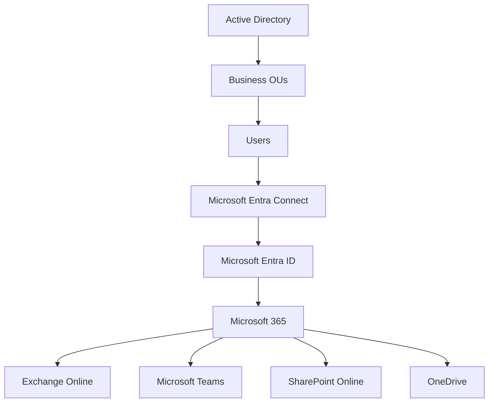
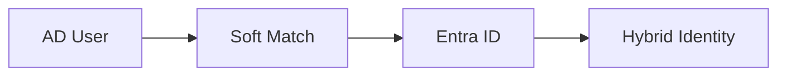
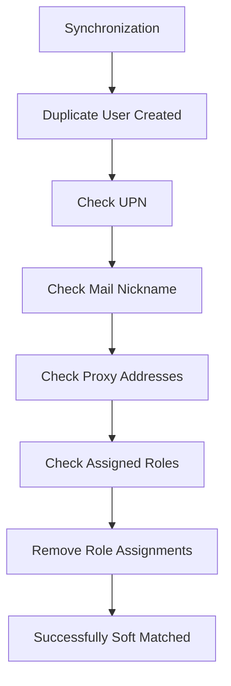

# Hybrid Identity Implementation with Microsoft Entra Connect

## Project Overview

Designed, deployed and validated a hybrid identity infrastructure by integrating an on-premises Active Directory environment with Microsoft Entra ID and Microsoft 365 using Microsoft Entra Connect.

This project demonstrates identity synchronization, Password Hash Synchronization (PHS), Password Writeback, Source of Authority concepts, user lifecycle management, soft matching, duplicate identity remediation and synchronization troubleshooting within a hybrid Microsoft enterprise environment.

---

# Environment Overview

## On-Premises Infrastructure

### Windows Server 2022

- Active Directory Domain Services (AD DS)
- DNS
- DHCP
- Group Policy
- File Services

### Active Directory Domain

```text
solotech.local
```

### Organisational Unit Structure

```text
solotech.local
│
├── Finance
├── HR
├── IT
├── Sales
├── Customer Service
└── Microsoft365-Hybrid
```

---

## Cloud Infrastructure

### Microsoft 365

- Exchange Online
- Microsoft Teams
- SharePoint Online
- OneDrive for Business
- Microsoft Purview

### Microsoft Entra ID

- Users
- Groups
- Conditional Access
- Administrative Units
- Identity Protection
- Self-Service Password Reset

---

# Objectives

The project was designed to:

- Synchronize identities between Active Directory and Microsoft Entra ID
- Establish Source of Authority for user administration
- Enable Password Hash Synchronization
- Configure Password Writeback
- Validate attribute synchronization
- Validate account lifecycle synchronization
- Migrate existing cloud identities into a hybrid identity model
- Investigate and resolve synchronization conflicts

---

# Architecture



---

# Active Directory Preparation

## UPN Configuration

Added a Microsoft 365 compatible UPN suffix.

### Before

```text
user@solotech.local
```

### After

```text
user@solotechinnovations.onmicrosoft.com
```

This allowed Active Directory users to use Microsoft 365 compatible identities.

---

## Hybrid Pilot OU

Created a dedicated synchronization OU:

```text
Microsoft365-Hybrid
```

Purpose:

- Synchronization testing
- Risk reduction
- Controlled onboarding

---

## Hybrid Test Users

Created:

```text
Hybrid User 1
Hybrid User 2
```

Configured:

- UPN
- Department
- Office
- Company

These users were used to validate synchronization behaviour.

---

# Microsoft Entra Connect Deployment

## Configuration

Installed:

```text
Microsoft Entra Connect Sync
```

Selected:

```text
Password Hash Synchronization (PHS)
```

Enabled:

```text
Password Writeback
```

Configured:

```text
OU Filtering
```

Initial synchronization initiated.

---

# Synchronization Scope

Initially synchronized:

```text
Microsoft365-Hybrid
```

Later expanded to:

```text
Finance
HR
IT
Sales
Customer Service
```

Excluded:

```text
Domain Controllers
Workstations
Servers
System Accounts
```

---

# Password Hash Synchronization

Configured:

```text
Password Hash Synchronization
```

Benefits:

- Single credential set
- Simplified authentication
- Cloud sign-in availability

Workflow:

```text
Password Change
        ↓
Active Directory
        ↓
Entra Connect
        ↓
Microsoft Entra ID
        ↓
Microsoft 365
```

---

# Password Writeback

Enabled:

```text
Password Writeback
```

Purpose:

```text
SSPR
        ↓
Microsoft Entra ID
        ↓
Password Writeback
        ↓
Active Directory
```

This enables hybrid self-service password reset scenarios.

---

# Active Directory Recycle Bin

Enabled:

```text
Active Directory Recycle Bin
```

Purpose:

- Fast recovery of deleted objects
- User restoration
- Group restoration

---

# Initial Synchronization Validation

Performed:

```powershell
Start-ADSyncSyncCycle -PolicyType Initial
```

Validated:

- User synchronization
- Object creation
- Scheduler operation

---

# Source of Authority Validation

## Test

Attempted to edit synchronized users directly within Microsoft 365.

### Result

```text
User property origin:
On-premises Active Directory
```

Editing restrictions applied.

### Learning Outcome

Active Directory remains the authoritative identity source in a hybrid environment.

---

# Attribute Synchronization Validation

Modified:

```text
Department
Job Title
Office
```

within Active Directory.

Executed:

```powershell
Start-ADSyncSyncCycle -PolicyType Delta
```

Result:

Changes synchronized successfully to:

- Microsoft Entra ID
- Microsoft 365

---

# User Lifecycle Management Validation

## Account Disablement

Disabled:

```text
Hybrid User
```

inside Active Directory.

Executed:

```powershell
Start-ADSyncSyncCycle -PolicyType Delta
```

Result:

```text
Account Disabled
```

in Microsoft Entra ID.

Validation completed successfully.

---

# Hybrid Identity Migration Challenge

## Existing Environment

Cloud user accounts were originally created directly within Microsoft 365.

Examples:

```text
david.carter@
emma.hughes@
herty.yankson@
```

---

## Synchronization Outcome

During synchronization some users successfully matched existing cloud identities.

Others generated duplicate identities.

Examples:

```text
miracle.botchway0932@
herty.yankson0604@
emma.hughes6677@
```

---

# Duplicate Identity Investigation

## Initial Assumption

Investigated:

- Department
- Employee ID
- Office
- Hire Date
- Display Name

Result:

No direct correlation identified.

---

## UPN Remediation

Updated Active Directory UPNs:

### Before

```text
user@solotech.local
```

### After

```text
user@solotechinnovations.onmicrosoft.com
```

Performed bulk remediation across all business OUs.

---

# Soft Match Testing

## Pilot User

```text
Abraham Botchway
```

Department:

```text
Sales
```

Result:

```text
On-premises Sync Enabled = Yes
```

No duplicate account was generated.

Soft Match successfully completed.

---

# Hybrid Identity Flow



---

# Administrative Role Investigation

Additional testing identified a key synchronization behaviour.

Users with existing Microsoft Entra administrative role assignments failed to soft match.

Examples:

```text
Helpdesk Administrator
Domain Name Administrator
Organizational Message Writer
Entra Backup Administrator
```

Affected Users:

- Miracle Botchway (IT)
- Alpha Botchway (HR)

---

# Troubleshooting Process

## Investigation Path



---

# Root Cause Discovery

Testing identified that cloud accounts with directly assigned Entra administrative roles did not soft match successfully.

After removing:

- Helpdesk Administrator
- Domain Name Administrator
- Agent ID Administrator
- Entra Backup Administrator
- Organizational Message Writer

and performing synchronization again:

```text
On-premises Sync Enabled = Yes
```

appeared successfully.

---

# Final Hybrid Identity Outcome

## Successfully Synchronized

```text
Finance
HR
IT
Sales
Customer Service
```

## Successfully Validated

- User synchronization
- Password Hash Synchronization
- Password Writeback
- Attribute Synchronization
- User disablement synchronization
- Source of Authority
- Soft Matching
- Identity remediation
- Administrative role troubleshooting

---

# Skills Demonstrated

## Active Directory

- User Administration
- OU Design
- UPN Management
- Attribute Management
- AD Recycle Bin

## Microsoft Entra ID

- Identity Synchronization
- Administrative Roles
- Conditional Access
- Administrative Units
- Identity Lifecycle Management

## Microsoft Entra Connect

- Installation
- OU Filtering
- Password Hash Synchronization
- Password Writeback
- Delta Synchronization
- Initial Synchronization

## Hybrid Identity

- Source of Authority
- Soft Matching
- Duplicate Identity Resolution
- Hybrid User Lifecycle
- Identity Troubleshooting

## PowerShell

```powershell
Start-ADSyncSyncCycle -PolicyType Initial

Start-ADSyncSyncCycle -PolicyType Delta

Get-ADSyncScheduler
```

---

# Key Lessons Learned

- UPN alignment is critical before synchronization.
- Pilot deployments reduce migration risk.
- Active Directory remains the Source of Authority in hybrid identity environments.
- Soft matching enables existing cloud identities to become hybrid identities.
- Administrative role assignments can complicate identity matching and migration scenarios.
- Hybrid identity migrations require planning, testing and validation before production implementation.

---

# Project Outcome

Successfully implemented a fully functional Hybrid Identity environment connecting:

```text
Windows Server Active Directory
        ↓
Microsoft Entra Connect
        ↓
Microsoft Entra ID
        ↓
Microsoft 365
```

while performing real-world troubleshooting, identity matching, duplicate remediation and lifecycle validation activities commonly encountered during enterprise Microsoft 365 migration projects.
